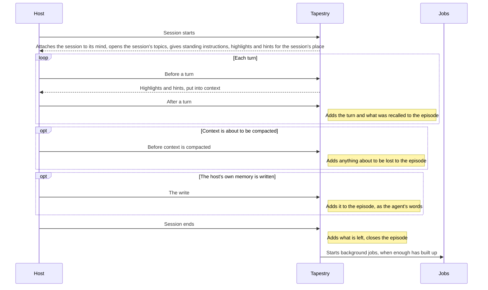

# Hooks

Where a host hands Tapestry control. The host is the runtime Tapestry lives inside: Hermes Agent, Claude Code or the Claude Agent SDK. The host runs the conversation, and Tapestry remembers it. Each host has hooks of its own, and a thin adapter maps them onto one fixed set.

## Hooks

| Hook | Tapestry does | Hermes | Claude Code / Agent SDK |
|---|---|---|---|
| Session starts | Attaches the session to its [mind](../primitives/MIND.md), opens the session's [topics](../primitives/TOPIC.md), gives standing instructions, and puts the [working memory](../primitives/WORKING_MEMORY.md) of the topics it searches, and [recall](../capabilities/RECALL.md)'s highlights and hints for the session's place, into context | Provider start-up | Session-start hook |
| Before a turn | [Recall](../capabilities/RECALL.md), and puts its highlights and hints into context | Prefetch | Prompt-submit hook |
| After a turn | Adds the turn, and what was recalled into it, to the session's [episode](../primitives/EPISODE.md) | Turn sync | Stop hook, reading the new part of the transcript |
| Before context is compacted | Adds anything about to be lost to the episode, so facts can still be drawn from it | Pre-compress | Pre-compact hook |
| Session ends | Adds what is left, closes the episode, and possibly starts [background jobs](JOBS.md), which draw its facts | Session end | Session-end hook |
| The host's built-in memory is written | Adds what was written to the episode, as something the agent wrote | Memory-write notification | Writes to its memory files |

The agent's [tools](TOOLS.md) are served through each host's own tool surface: provider tools in Hermes, an MCP server in Claude Code and the Agent SDK.

## Which mind a session attaches to

Each adapter tells Tapestry which mind a session attaches to, which topics to open, and the place the session happened in, if it has one:

- **Hermes:** the agent's profile (Ash, Wren) names the mind, and the profile's key on that machine reaches it. It opens no topics by default, and a session has no place.
- **Claude Code and the Agent SDK:** the user's own mind, through Claude Code's key on that machine, unless the user attaches the session to another of their minds through [commands](COMMANDS.md). The session's place is the current project, named after the repository, and the session opens that topic.

Subagents use their parent's mind. A session attaches only to a mind its agent holds a [key](../primitives/KEY.md) to on that machine, and the same repository checked out on two machines is one place.

## Invariants

- One core, many adapters. Adapters translate between the host and Tapestry and contain no memory logic. A behaviour that differs by host is a bug.
- The host never reaches a mind's storage directly.
- Host quirks are absorbed by the adapter, never by the core. Examples:
  - a loader that only finds plugins by scanning for certain text;
  - a sanitizer that deletes certain text from memory content;
  - a runtime that quietly swallows errors raised during recall.
- A host missing a hook gets a visible fallback, never silent memory loss.
- The host's built-in memory keeps working. What the agent writes there is the agent's own words in the episode, drawn like anything else it said: never a memory on its own, and never a replacement for what the user said.
- Moving between hosts or machines loses nothing. The same mind can be attached to from any host, on any machine, by any agent holding a key to it.
- **A machine that can't reach its mind keeps the session's turns, and adds them to the episode once it can.** Until then, recall says it failed, and kept turns are never shown as remembered. They're added with the moments they happened and the key they came from, and a turn added twice is added once. A read-only key keeps nothing.
