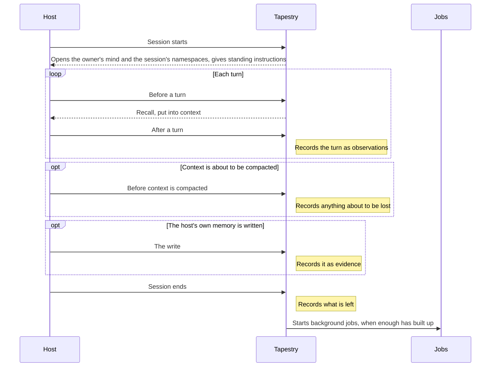

# Hooks

Where a host hands Tapestry control. The host is the runtime Tapestry lives inside: Hermes Agent, Claude Code or the Claude Agent SDK. The host runs the conversation, and Tapestry remembers it. Each host has hooks of its own, and a thin adapter maps them onto one fixed set.

## Hooks

| Hook | Tapestry does | Hermes | Claude Code / Agent SDK |
|---|---|---|---|
| Session starts | Opens the owner's [mind](../primitives/MIND.md), opens the session's [namespaces](../primitives/NAMESPACE.md), gives standing instructions | Provider start-up | Session-start hook |
| Before a turn | [Recall](../capabilities/RECALL.md), and puts the results into context | Prefetch | Prompt-submit hook |
| After a turn | Records the turn as [observations](../primitives/MEMORY.md) | Turn sync | Stop hook, reading the new part of the transcript |
| Before context is compacted | Records anything about to be lost | Pre-compress | Pre-compact hook |
| Session ends | Records what is left, and possibly starts [background jobs](JOBS.md) | Session end | Session-end hook |
| The host's built-in memory is written | Records the write as [evidence](../primitives/EVIDENCE.md) | Memory-write notification | Writes to its memory files |

The agent's [tools](TOOLS.md) are served through each host's own tool surface: provider tools in Hermes, an MCP server in Claude Code and the Agent SDK.

## Who owns the mind

Each adapter tells Tapestry whose mind a session belongs to, which namespaces to open, and the place the session happened in, if it has one:

- **Hermes:** the agent's profile (Ash, Wren) owns the mind. It opens no namespaces by default, and a session has no place.
- **Claude Code and the Agent SDK:** the user owns the mind. The session's place is the current project, named after the repository, and the session opens that namespace.

Subagents use their parent's mind.

## Invariants

- One core, many adapters. Adapters translate between the host and Tapestry and contain no memory logic. A behaviour that differs by host is a bug.
- The host never reaches a mind's storage directly.
- Host quirks are absorbed by the adapter, never by the core. Examples:
  - a loader that only finds plugins by scanning for certain text;
  - a sanitizer that deletes certain text from memory content;
  - a runtime that quietly swallows errors raised during recall.
- A host missing a hook gets a visible fallback, never silent memory loss.
- The host's built-in memory keeps working. Tapestry records its writes as the agent's own notes: low-weight evidence, never a replacement for what the user said.
- Moving between hosts loses nothing. The same mind can be opened from any host that serves its owner.
