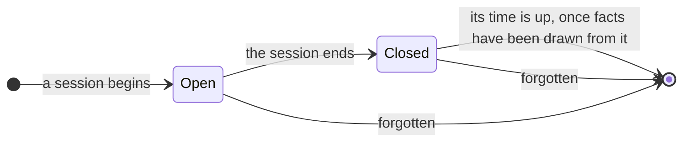

# Episode

A conversation as it happened: what the user and the agent said in one session, word for word, attributed to whoever said it. It is a mind's short-term record, the way a person remembers a conversation for a while but keeps what it taught. An episode is not a [memory](MEMORY.md): memories are drawn from it, and then its words are allowed to fade.

An episode is source material. It's used for two things: drawing facts from it, and showing where a fact came from. Recall never returns it, and no agent is shown one as something remembered.

## Invariants

- **An episode is never a memory, and is never recalled.** Its words reach an agent only as the source of a fact, while the episode is still kept.
- An episode records what the user and the agent said, attributed to each, and which memories were recalled into each moment. Words the user pasted from someone else belong to that someone.
- An episode is added to while its session lasts and is never edited. Adding the same turn twice adds it once, and a turn that can't be added is reported, never silently lost.
- **An episode is kept for a limited time after it ends, then it is gone entirely.** The limit is a tuning decision.
- **An episode never goes before facts have been drawn from it,** unless drawing them failed, which is reported. Nothing a conversation taught is lost to the passing of time unread.
- An episode knows the session it belongs to and the place the session happened in, so the facts drawn from it can be filed where they matter.
- **Forgetting a memory removes the words it came from out of every episode that holds them.** Afterward no episode says what was forgotten.
