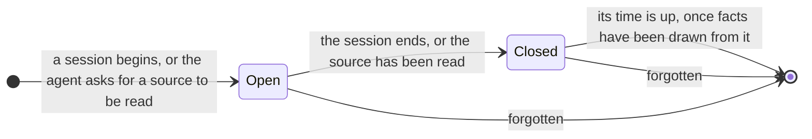

# Episode

Something a mind met, as it happened: a conversation, or a reading. A conversation is what the user and the agent said in one session, word for word, attributed to whoever said it. A reading is a source the agent chose to learn from, such as a web page, a paper or a document, as it read when it was read, attributed to the source. Both are the same kind of thing: what separates them is who was speaking and how much of it is worth keeping. An episode is a mind's short-term record, the way a person remembers a conversation or an article for a while but keeps what it taught. It is not a [memory](MEMORY.md): memories are drawn from it, and then its words are allowed to fade.

An episode is source material. It's used for two things: drawing facts from it, and showing where a fact came from. Recall never returns it, and no agent is shown one as something remembered.

## Invariants

- **An episode is never a memory, and is never recalled.** Its words reach an agent only as the source of a fact, while the episode is still kept.
- A conversation records what the user and the agent said, attributed to each, and which memories were recalled into each moment. Words the user pasted from someone else belong to that someone.
- **A reading's words belong to its source, never to the user or the agent.** It records where the source is found and when it was read, and its words as they stood then.
- A reading is asked for in a session, by the agent, and only for a source it chose. It knows that session and the topic it was read for. A source is read when it is asked for, so a source that can't be read says so then, and is never silently left unread.
- An episode is added to while it is open and is never edited. Adding the same turn twice adds it once, and a turn that can't be added is reported, never silently lost.
- **An episode is kept for a limited time after it ends, then it is gone entirely.** The limit is a tuning decision.
- While an episode is kept, its owner can have it drawn again: what drawing it gave is taken back, and it waits to be drawn as though it never had been.
- **An episode never goes before facts have been drawn from it,** unless drawing them failed, which is reported. Nothing a conversation or a reading taught is lost to the passing of time unread.
- An episode knows the session it belongs to and the place the session happened in, so the facts drawn from it can be filed where they matter.
- **Forgetting a memory removes the words it came from out of every episode that holds them.** Afterward no episode says what was forgotten.
