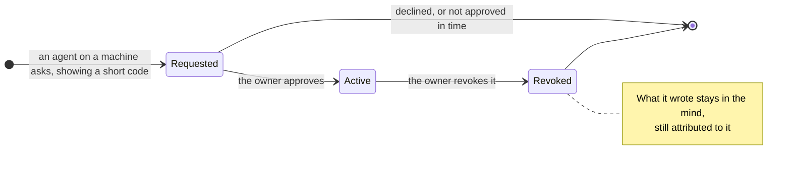

# Key

What lets one agent, on one machine, attach to one [mind](MIND.md). The person whose [account](ACCOUNT.md) owns the mind approves each key. Ash on the workstation and Ash on a laptop hold two keys to the same mind. Claude Code and Ash can each hold a key to the same mind, and every entry they write says which of them it came from.

Every session attaches through exactly one key. That is how a mind knows which agent, on which machine, each thing came from, and why one agent or one machine can be cut off without touching anything else.

## Invariants

- **A key names one agent, one machine and one mind.** It never lists, reads or writes any other mind, even one owned by the same account.
- A session attaches only to a mind its agent holds a key to on that machine.
- A key exists only once the owner approves it. The request names the agent and the machine, and the request and the approval show the same short code, so the owner approves the agent in front of them, not just any request.
- The secret part of a key never leaves the machine that holds it. Tapestry keeps only what it needs to recognise the key.
- A key reaches its mind either to read only, or to read and write. A session on a read-only key is told that nothing it says will be remembered. It's never shown as remembering when it isn't.
- **Every entry a session writes names the key it attached through**, so which agent wrote it, and from where, is always known, and everything a key wrote can always be found.
- Revoking a key takes effect on the next thing it tries. What it already wrote stays in the mind, still attributed to it.
- An agent whose key is missing, refused or revoked is told so. It's never shown an empty mind in place of one it couldn't reach.
