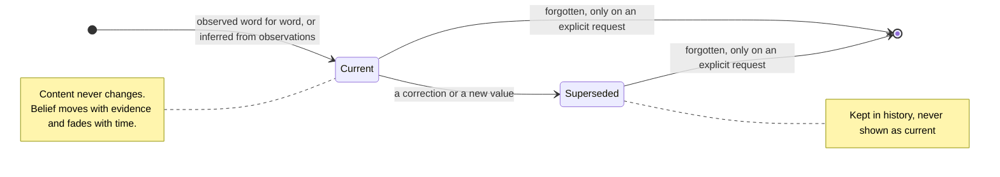

# Memory

Anything remembered. It might be something said or done, kept word for word; something inferred from those; or a name that other memories gather around, such as a person, a project or a topic. These are all the same kind of thing. What separates an observation from a belief or a concept is where it came from and how it's connected, not a declared type.

A memory has two halves that behave in opposite ways. Its content is fixed the moment it exists. Its [evidence](EVIDENCE.md) only ever grows. How much it's believed is never kept on the memory: it's read off the evidence, at a moment, which is why belief fades when nothing renews it and why it can always be explained.

Whether something new confirms, contradicts or replaces a memory takes judgment, so a model makes that call: the agent in conversation, or a model working in the background. The model only proposes. Its call goes through the same checks as any other evidence, and how belief moves once the call is made is fixed.

## Invariants

- **A memory's content never changes.** A correction is a new memory that supersedes the old one. When the user states a new value for something that holds one value at a time ("my favorite color is blue now"), the old memory is superseded, not merely doubted. A superseded memory stays in the mind's history, marked as superseded.
- **Belief is read from evidence, never stored or granted.** Replaying a memory's evidence gives its confidence at any moment. The same rules weigh evidence whatever produced it. Changing how much a kind of source is trusted changes future readings, never the evidence.
- Confidence answers two questions: *was this right when it was last checked*, and *is it still right now*. Nothing renews itself. Without fresh evidence, confidence fades at a rate set by how quickly that kind of thing changes. A name barely fades, a preference slowly does, and a plan expires. What a session was in the middle of is the fastest kind: it fades within days, and finishing the work supersedes it. It is recalled only when a moment bears on it, never as part of who the agent is.
- **Only what happens outside the mind moves belief.** Recalling, repeating or relying on a memory is never evidence for it.
- Belief is hard to move and hard to fake. A single weak contradiction doesn't topple a long record of confirmations, and the same source repeating itself counts once.
- An observation records what was said, done or returned, word for word, attributed to whoever it came from. Words the user pasted from someone else belong to that someone. It can be recalled the moment it's recorded. Recording the same moment twice gives one observation, and a moment that can't be recorded is reported, never silently lost.
- Observations have the strongest footing in the mind, but they can be wrong too, for example misattributed or mistranscribed.
- A memory inferred from observations claims no more than they say, keeps their names, numbers and dates exactly, and starts no more confident than they justify. It's drawn from observations only, never from other inferences, so mistakes can't compound.
- A memory can say what would make it stop being true. That condition is itself a memory, associated with the one it would defeat. When it seems to have come true, it's checked before it counts, and then it counts as a contradiction. A judgment that can't be made yet leaves the memory marked as possibly out of date until it is. Nothing is guessed in its place.
- **A memory ends only when its owner asks to forget it.** Fading, superseding and inferring never delete. A memory nothing reaches fades from recall but is never destroyed. Forgetting is complete: the memory, its evidence, its associations, and any memory inferred from it alone. Afterward the mind can say that something was forgotten, never what.
