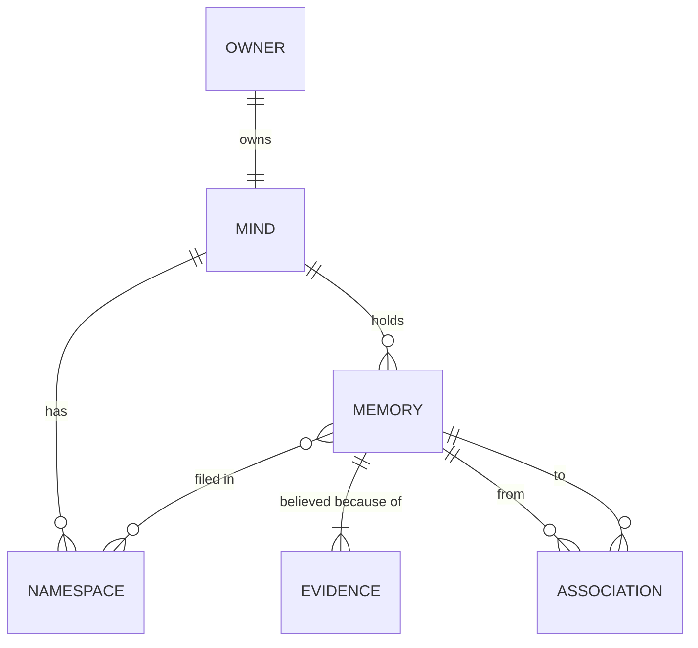

# Mind

Everything one identity remembers: its [memories](MEMORY.md), the [associations](ASSOCIATION.md) between them, and the [evidence](EVIDENCE.md) behind them. A mind is who sessions are the continuation of. Every session attaches to one, and what it learns joins that mind's one record, so the next session, on any machine, picks up as the same someone. The owner might be an agent like Ash, or a person working with an agent, as in Claude Code, and one owner can keep several minds. A mind is the hard boundary of privacy and the unit Tapestry serves. Inside a mind, [namespaces](NAMESPACE.md) decide what a lookup can see without walling anything off.

## Invariants

- A mind belongs to exactly one owner, and every memory, association and piece of evidence belongs to exactly one mind.
- **A mind is one identity, however many sessions it has.** Sessions on different machines and in different hosts can attach to the same mind, and what each records becomes part of the same record. Which mind a session attaches to is chosen when it starts, and never changes during it.
- Several minds can exist side by side, on one machine or for one owner. Each is a separate identity: they share nothing unless something is deliberately shared.
- A mind that is behind, because another session's record hasn't reached it yet, catches up before it is next consulted where it can. Until it has, anything recalled from it says it may be behind.
- **Identity is a memory.** A mind's own name is a concept [memory](MEMORY.md), like a person or a project, and who the mind is gathers around it. Nothing tells a mind who it is that its memories don't say, and what it has learned over time is only more memories.
- **Minds are private.** No session reads or writes a mind it isn't attached to.
- Sharing is deliberate and rare. When one agent shares something, the receiving mind records it as evidence *from that agent*. It never takes on the other mind's belief or its confidence.
- A model asked to judge something sees one mind at a time, and never more of it than the question needs.
- A mind that can't be consulted says so. An agent is never shown "nothing relevant" when its mind was never actually searched.
