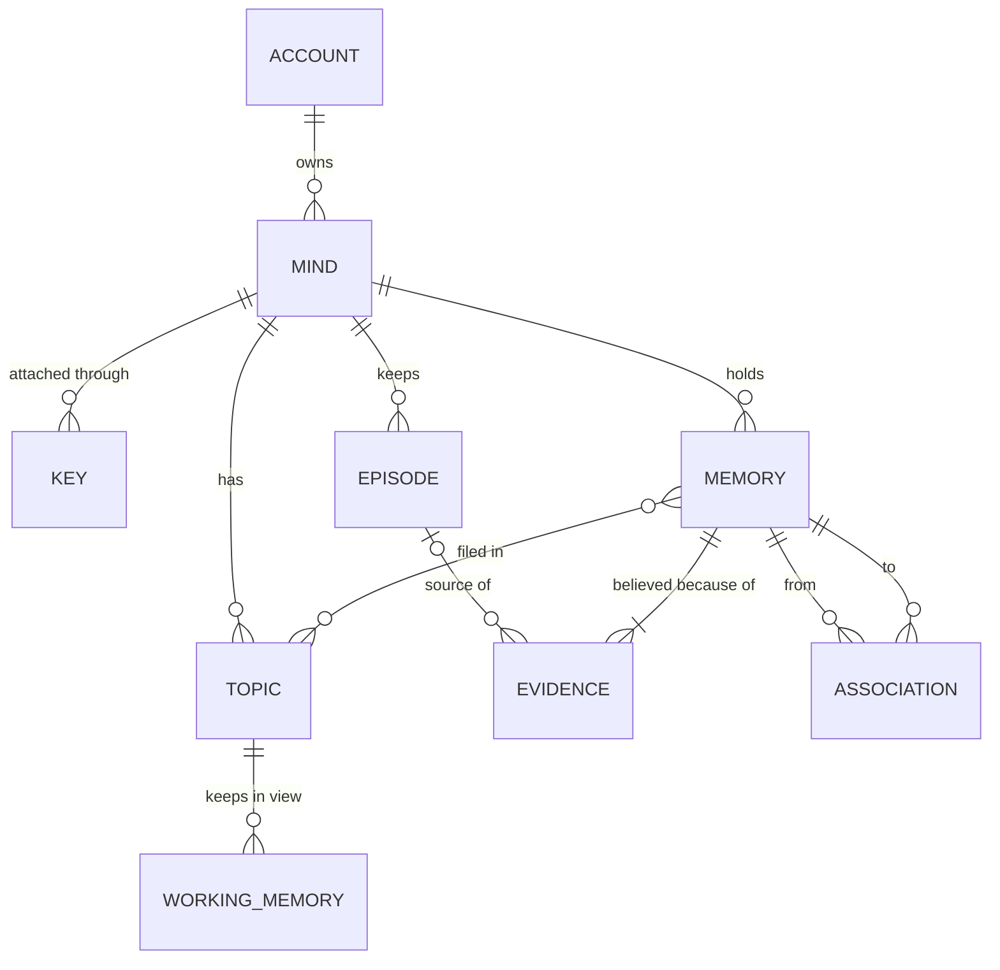

# Mind

Everything one identity remembers: its [memories](MEMORY.md), the [episodes](EPISODE.md) they were drawn from, the [associations](ASSOCIATION.md) between memories, and the [evidence](EVIDENCE.md) behind them, with the [working memory](WORKING_MEMORY.md) it is keeping in view. A mind is who sessions are the continuation of. Every session attaches to one, and what it learns joins that mind's one record, so the next session, on any machine, picks up as the same someone. The owner is always a person, whose [account](ACCOUNT.md) owns the mind, and one owner can keep several minds: Will's own mind, which Claude Code attaches to, and the minds Ash and Wren attach to, are all Will's. Agents attach to a mind through [keys](KEY.md). A mind is the hard boundary of privacy and the unit Tapestry serves. Inside a mind, [topics](TOPIC.md) decide what a lookup can see without walling anything off.

## Invariants

- A mind belongs to exactly one account, and every memory, episode, association, piece of evidence and working memory belongs to exactly one mind.
- **A mind is one identity, however many sessions it has.** Sessions on different machines and in different hosts can attach to the same mind, and what each records becomes part of the same record. Which mind a session attaches to is chosen when it starts, and never changes during it.
- Several minds can exist side by side for one owner. Each is a separate identity: they share nothing unless something is deliberately shared.
- **A mind lives in one place.** Every machine reaches that one mind, and none keeps a copy of its own that could drift from it.
- A mind is behind only while a machine holds turns it couldn't add, because it couldn't reach the mind. That machine says so in every session it serves until they're added, and adds them as soon as it reaches the mind again.
- Identity is what the mind knows about itself. Its own name, who it works with and how it works are [memories](MEMORY.md) like any others. Nothing tells a mind who it is that its memories don't say, and what it has learned over time is only more memories.
- **Minds are private.** No session reads or writes a mind it isn't attached to, and nothing outside the owner's account reaches a mind at all.
- When whoever runs Tapestry reads a mind, rather than its owner or an agent holding a key, it is recorded, and the owner can always see that record.
- Sharing is deliberate and rare. Agents attached to the same mind aren't sharing: they are sessions of one identity. When something passes from one mind to another, the receiving mind records it as evidence *from the agent that passed it*. It never takes on the other mind's belief or its confidence.
- A model asked to judge something sees one mind at a time, and never more of it than the question needs.
- A mind that can't be consulted says so. An agent is never shown "nothing relevant" when its mind was never actually searched.
