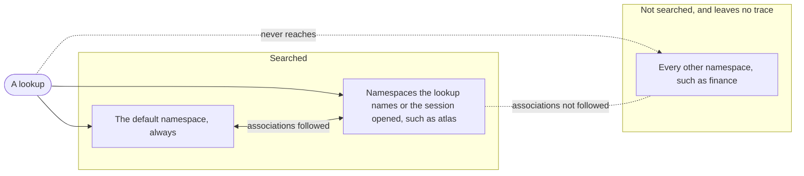

# Namespace

A named region of a [mind](MIND.md) that stays out of sight until asked for: everything the owner knows about one person, one topic or one project, such as `will`, `finance` or `atlas`. Memories that matter in every context live in the default namespace, which is always searched. A namespace is searched only when a lookup names it, or when the session has opened it. Otherwise its memories behave as if they don't exist.

Opening a namespace makes what the mind knows about something available, much as loading a skill makes a way of working available. Like a skill, every namespace has a name and a short description, and the agent can always see the list. It never sees a namespace's contents until it asks for them.

A mind is one web of memories, and namespaces don't cut it apart. They decide what a lookup can see.

## Invariants

- The default namespace is always searched. A [memory](MEMORY.md) that belongs to no namespace lives there.
- A memory can belong to several namespaces. It's visible when any one of them is searched. "Will's salary" can be in both `will` and `finance`, and either one brings it back.
- **A namespace that isn't searched leaves no trace.** Its memories, and the associations that lead into them, don't show up in results, don't affect ranking and don't count against any limit.
- Every namespace has a description the agent can read without opening it. Contents are only ever revealed by opening it.
- A lookup can name namespaces to search alongside the default. A session can also open namespaces for all its lookups, and every opening is visible.
- **Associations can cross namespaces.** Recall follows one only when both ends are visible.
- A memory belongs in the default namespace when it matters in every context, and in a namespace when it matters only there. "Will prefers terse answers" is default. "Atlas runs its tests with pytest" is `atlas`.
- A memory drawn from a conversation is filed by what it concerns: in the namespace of the place the conversation happened in when it matters only there, in a person's or a topic's namespace when it concerns them, and in the default only when it matters in every context. When that isn't clear it is filed narrowly, never in the default, and never in a namespace only because the session opened it.
- Adding a memory to a namespace or removing it is recorded as [evidence](EVIDENCE.md), never done silently.
- Namespaces are flat. They are soft partitions within one mind, and never a way into another mind.
- A memory kept out of a namespace is protected only by being kept out of every namespace that is searched. Anything sensitive belongs in a narrow namespace, not also filed somewhere broad.
