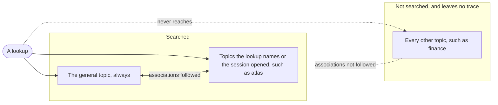

# Topic

A named region of a [mind](MIND.md) that stays out of sight until asked for: everything the owner knows about one person, one subject or one project, such as `will`, `finance` or `atlas`. Memories that matter in every context live in the general topic, which is always searched. Any other topic is searched only when a lookup names it, or when the session has opened it. Otherwise its memories behave as if they don't exist.

Opening a topic makes what the mind knows about something available, much as loading a skill makes a way of working available. Like a skill, every topic has a name and a short description, and the agent can always see the list. It never sees a topic's contents until it asks for them.

A mind is one web of memories, and topics don't cut it apart. They decide what a lookup can see, and [associations](ASSOCIATION.md) decide what comes to mind among what it sees.

## Invariants

- The general topic is always searched. A [memory](MEMORY.md) filed in no other topic lives there.
- A memory can belong to several topics. It's visible when any one of them is searched. "Will's salary" can be in both `will` and `finance`, and either one brings it back.
- **A topic that isn't searched leaves no trace.** Its memories, and the associations that lead into them, don't show up in results, don't affect ranking and don't count against any limit.
- **Filing a memory in a topic is never an association.** Belonging to a topic is all or nothing, and nothing fades out of a topic on its own.
- Every topic has a description the agent can read without opening it. Contents are only ever revealed by opening it.
- **A hint that an unopened topic bears on the moment is judged from its name and description alone.** It reveals nothing the topic holds, so a description says what the topic holds, not just what it's called.
- A lookup can name topics to search alongside the general one. A session can also open topics for all its lookups, and every opening is visible.
- A memory belongs in the general topic when it matters in every context, and in another topic when it matters only there. "Will prefers terse answers" is general. "Atlas runs its tests with pytest" is `atlas`.
- A memory drawn from a conversation is filed by what it concerns: in the topic of the place the conversation happened in when it matters only there, in a person's or a subject's topic when it concerns them, and in the general topic only when it matters in every context. When that isn't clear it is filed narrowly, never in the general topic, and never in a topic only because the session opened it.
- Adding a memory to a topic or removing it is recorded as [evidence](EVIDENCE.md), never done silently.
- Topics are flat. They are soft partitions within one mind, and never a way into another mind.
- A memory kept out of a topic is protected only by being kept out of every topic that is searched. Anything sensitive belongs in a narrow topic, not also filed somewhere broad.
