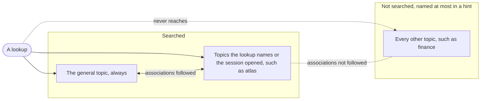

# Topic

A named region of a [mind](MIND.md) that stays out of sight until asked for: everything the owner knows about one person, one subject or one project, such as `will`, `finance` or `atlas`. Memories that matter in every context live in the general topic, which is always searched. Any other topic is searched only when a lookup names it, or when the session has opened it. Otherwise its memories behave as if they don't exist.

Opening a topic makes what the mind knows about something available, much as loading a skill makes a way of working available. Like a skill, every topic has a name and a short description, and the agent can always see the list. It never sees a topic's contents until it asks for them.

A topic is drawn around what is wanted together. Its edge sits where a conversation would want what is on one side without what is on the other, and nowhere else: kinds of thing that are asked about together are one topic, however different they are.

A topic can sit under another, as `atlas/billing` sits under `atlas`, when a part of a subject is wanted without the rest of it. A topic is everything under it too: the topic above is the whole subject, and the one under it is a part that can be searched alone.

A mind is one web of memories, and topics don't cut it apart. They decide what a lookup can see, and [associations](ASSOCIATION.md) decide what comes to mind among what it sees.

## Invariants

- The general topic is always searched. A [memory](MEMORY.md) filed in no other topic lives there.
- A memory can belong to several topics. It's visible when any one of them is searched. "Will's salary" can be in both `will` and `finance`, and either one brings it back.
- **Searching a topic searches everything under it, and nothing above or beside it.** Opening `atlas` searches `atlas/billing`. Opening `atlas/billing` searches neither `atlas` nor `atlas/deploys`.
- A topic exists because a conversation would want what it holds without what is beside it. What is wanted together is one topic, and sorting within it is left to associations: the people in `atlas` and its decisions are one topic, and `atlas/billing` is another when whoever does the accounts wants it without the rest.
- A memory filed in a topic is not seen from a topic under it, so a memory is filed in the narrowest topic it belongs to, and in the topic above only when it concerns the whole.
- A topic sits under at most one other, and that one exists. A topic can hold memories of its own as well as topics under it, and nothing sits under the general topic.
- **A topic that isn't searched leaves no trace in what's recalled.** Its memories, and the associations that lead into them, don't show up in results, don't affect ranking and don't count against any limit. The most it can do is be named in a hint.
- **Filing a memory in a topic is never an association.** Belonging to a topic is all or nothing, and nothing fades out of a topic on its own.
- Every topic has a description the agent can read without opening it, and a description says what the topic holds, not just what it's called. Contents are only ever revealed by opening it.
- The agent always sees the topics at the top, each with how much it holds counting what is under it, and the topics that are open wherever they sit. It sees the topics under one by asking.
- **A hint names an unopened topic, the one the memory is filed in however far down, never what it holds.** It may be judged from the topic's memories, so a topic that holds nothing bearing on the moment isn't hinted, but no memory, and nothing a memory says, crosses into the hint. The agent sees what matched only by opening the topic.
- A lookup can name topics to search alongside the general one. A session can also open topics for all its lookups, and every opening is visible.
- A memory belongs in the general topic when it matters in every context, and in another topic when it matters only there. "Will prefers terse answers" is general. "Atlas runs its tests with pytest" is `atlas`.
- A memory drawn from a conversation is filed by what it concerns: in the topic of the place the conversation happened in when it matters only there, in a person's or a subject's topic when it concerns them, and in the general topic only when it matters in every context. When that isn't clear it is filed narrowly, never in the general topic, and never in a topic only because the session opened it.
- Adding a memory to a topic or removing it is recorded as [evidence](EVIDENCE.md), never done silently.
- A topic's [working memory](WORKING_MEMORY.md) is shown when the topic is searched, and is the one thing of a topic's that is shown without being looked for.
- Topics are soft partitions within one mind, and never a way into another mind.
- A memory kept out of a topic is protected only by being kept out of every topic that is searched, and a topic under one that is searched is searched. Anything sensitive belongs in a narrow topic, not also filed somewhere broad, and not under a broad one.
